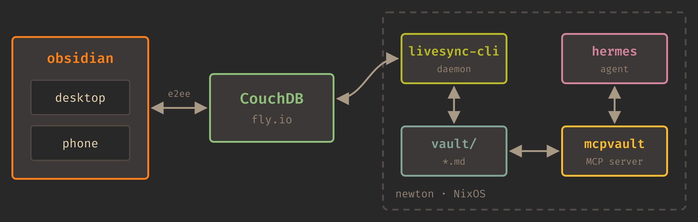

In my previous post, [Two months of
Hermes](/blog/2026/10/17/two-months-of-hermes/), I mentioned a headless
livesync instance of my Obsidian notes. My agent, running on an old Macbook in
my basement, is able to read and write to it, and changes appear on my phone or
desktop a moment later. Here's how I did it.



## Ingredients

- [Self-hosted LiveSync](https://github.com/vrtmrz/obsidian-livesync), the Obsidian plugin that syncs a vault through CouchDB, end-to-end encrypted. This is installed on desktop and mobile devices.
- CouchDB, on a virtually free [fly.io](https://fly.io/) machine (but could run on my local server), used by LiveSync.
- LiveSync's [headless CLI](https://github.com/vrtmrz/obsidian-livesync/blob/main/src/apps/cli/README.md), running in daemon mode on the same machine as Hermes.
- [mcpvault](https://github.com/bitbonsai/mcpvault), an MCP server that gives the agent tools for searching and editing a vault on disk.

The LiveSync daemon and the MCP server never talk to each other; they only share a directory. When I edit a note on my laptop, the plugin pushes it to CouchDB, the CLI pulls it down and writes the file, and Hermes sees it the next time it looks. When Hermes writes a file, the CLI notices, encrypts it, and pushes it up, and every other device grabs it from there.

## Why not just run Obsidian?

My Hermes installation is on a headless server (well, it's a laptop, so it isn't technically headless, but I leave it closed and on a rack shelf), and I don't want to run a full Electron app on it. 
I also didn't want to pay for an Obsidian Sync subscription when I already had everything I needed to do it myself, and I've worked with CouchDB enough to be comfortable running it.

And, it turns out that the LiveSync plugin repo includes a CLI in `src/apps/cli`. It wasn't in
nixpkgs or published anywhere as a standalone binary, so I packaged it myself.

## Packaging the CLI

The CLI lives inside the plugin's repo, so we pull a copy of the whole repository, then use Nix's `buildNpmPackage` to build just the `self-hosted-livesync-cli` component.

We don't want the `edgedriver` and `geckodriver` devDependencies, since they aren't useful for the CLI build and would fail inside a Nix sandbox anyway, so skip them with `--ignore-scripts`.

I wasn't familiar with `leveldown`, but the build needs it, and we need a version that will run under NixOS, so remove the existing binaries and rebuild from source instead.

```nix
npmFlags = ["--ignore-scripts"];
nativeBuildInputs = [pkgs.python3 pkgs.makeWrapper pkgs.patchelf];
buildInputs = [pkgs.stdenv.cc.cc.lib];

preBuild = ''
  rm -rf node_modules/leveldown/prebuilds
  npm rebuild leveldown --foreground-scripts
'';
```

The final install step just needed `node_modules` (minus any dangling symlinks), the `dist` output, and a wrapper script:

```nix
installPhase = ''
  mkdir -p $out/lib/livesync-cli
  cp -r node_modules      $out/lib/livesync-cli/node_modules
  cp -r src/apps/cli/dist $out/lib/livesync-cli/dist
  find $out/lib/livesync-cli/node_modules -xtype l -delete

  makeWrapper ${nodejs}/bin/node $out/bin/livesync-cli \
    --add-flags $out/lib/livesync-cli/dist/index.cjs \
    --prefix LD_LIBRARY_PATH : ${pkgs.lib.makeLibraryPath [pkgs.stdenv.cc.cc.lib]}
'';
```

The whole thing lives in its own flake under `inputs/livesync-cli` in my [nix-config](https://github.com/emptyflask/nix-config/blob/main/inputs/livesync-cli/flake.nix).

## The NixOS module

The same flake exports a module that wraps the CLI in a systemd service. By default it follows CouchDB's live `_changes` feed, which is one of the nicest parts of CouchDB, and probably the reason the LiveSync developer decided to use it.

The module creates a dedicated `livesync` user by default, but then Hermes needs write access to the vault, and you end up juggling groups and umasks so that files created by one service are writable by the other. Running the sync daemon as the `hermes` user avoids all of that:

```nix
services.livesync-cli = {
  enable = true;
  user = "hermes";
  group = "hermes";
  databasePath = "/var/lib/livesync/db";
  vaultPath = "/var/lib/hermes/vault";
  settingsFile = config.age.secrets.livesync-settings.path;
};
```

## Secrets

LiveSync's settings file holds the CouchDB URL, the credentials, and the end-to-end encryption passphrase, so the entire file is a secret. It's encrypted with [agenix](https://github.com/ryantm/agenix) and decrypted at activation to a path readable only by `hermes`.

The easiest way to get a correct settings file is to let the CLI write it. Export a Setup URI from an existing Obsidian client, then:

```sh
livesync-cli ./db --settings settings.json setup "<setup uri>" --write-settings
```

Add a restart trigger on the encrypted file, since the daemon needs to re-read changed secrets:

```nix
systemd.services.livesync-cli.restartTriggers = [
  config.age.secrets.livesync-settings.file
];
```

## Giving Hermes access to the vault

Now that the vault files are on the disk, it's pretty simple to give access to the agent. Just add mcpvault and point it to the path:

```nix
mcpVault = {
  command = "${pkgs.nodejs}/bin/npx";
  args = ["@bitbonsai/mcpvault@latest" config.services.livesync-cli.vaultPath];
};
```

Restic backs up `/var/lib/livesync` and `/var/lib/hermes` to B2 nightly, so between that, the CouchDB copy, and every synced device, the vault exists in more places than I'll ever need.

## How it's held up

It's been running since August with only a couple of sync conflicts, each fixed by picking the newer version. I'm usually directing the LLM's edits, so it's easy to avoid touching the same notes simultaneously. If I happen to be working on it while Hermes begins a monthly cleanup, or if I give it more automated tasks within the vault, there might be more conflicts, but it might actually be able to resolve them easily.

Some of the things it does now:
- It files recipes from URLs into a template, and can retrieve them for weekly meal planning.
- Daily notes / to-do lists are folded into monthly and yearly digests.
- I can give it a URL related to a project, and it will append a section to my main project note.

If you're already using LiveSync, give it a shot. If you aren't using Nix, there's a [Dockerfile](https://github.com/vrtmrz/obsidian-livesync/blob/main/src/apps/cli/Dockerfile) for the CLI tool.
